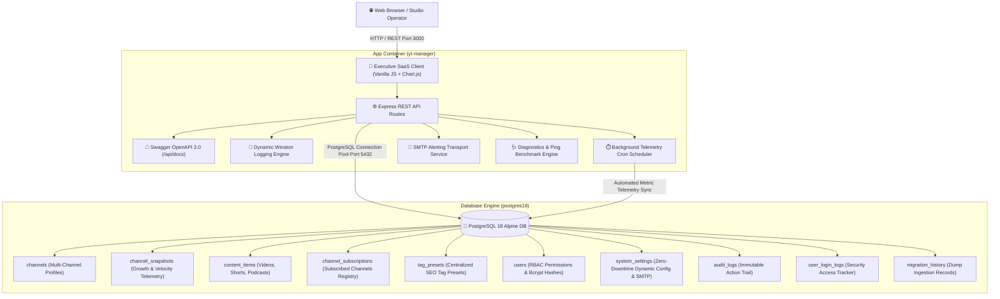

# 🚀 YouTube Channel Manager (`youtube-channel-manager`)

> **Next-Generation Executive Multi-Channel YouTube Operations & Studio Platform**  
> Powered by **Node.js 20 LTS, PostgreSQL 18 Alpine, Docker Compose & Professional Executive SaaS UI**  
> Engineered by **[Ibrar Ansari](https://github.com/meibraransari)** for creators, multi-channel networks (MCNs), media production studios, and DevOps educators.

[](https://hub.docker.com/r/ibraransaridocker/yt-manager-app)
[](https://nodejs.org/)
[](https://www.postgresql.org/)
[](LICENSE)
[](https://github.com/meibraransari/youtube-channel-manager)

---

## 📖 Overview

**YouTube Channel Manager** is a high-performance, containerized studio operations hub designed to manage multiple YouTube channels from a single unified control plane.

Built with an executive SaaS aesthetic featuring deep dark modes, frosted pearlescent light modes, rounded metrics charts, and a GitHub-style 365-day cadence heatmap, the platform brings enterprise-grade management to YouTube Shorts / Reels (9:16), long-form tutorials (16:9), and podcasts. It features rapid YouTube channel onboarding, telemetry snapshots, an automated cron sync engine for metrics (views, likes, comments, subscribers), granular RBAC permissions, live immutable audit trails, dynamic zero-downtime database settings, an interactive 5-stage Content Creator Wizard, a production SMTP alerting subsystem, a centralized Tag Preset Registry, and a full-spectrum Server Health & Diagnostics observability suite.

---

## 🎯 Why YouTube Channel Manager?

Operating multi-channel networks and complex content production pipelines often creates operational bottlenecks:

- **Multi-Channel Fragmentation**: Creators managing several channels struggle to isolate catalogs and analyze individual channel velocity in one centralized console.
- **Legacy Ingestion Hurdles**: Onboarding existing channels or converting legacy MariaDB/MySQL dumps (e.g., from n8n automation pipelines) requires complex custom scripts.
- **Downtime Configuration**: Adjusting backend logging levels, testing SMTP gateways, or toggling Swagger API docs usually demands rebuilding images or restarting containers.
- **Metric Desynchronization**: Views, likes, and subscriber metrics become stale without an automated background scheduler and snapshot telemetry engine.
- **Absence of Immutable Audit Trails**: Multi-operator studios lack accountability when titles, thumbnails, prompts, or release dates are altered.
- **Observability Blind Spots**: Containerized deployments lack real-time visibility into database connection pool saturation, V8 heap memory pressure, and query roundtrip latencies.

**YouTube Channel Manager** solves this with a unified, zero-downtime architecture providing instantaneous multi-channel switching, automatic telemetry cron synchronization, and seamless MySQL-to-PostgreSQL migration.

---

## ✨ Comprehensive Feature Suite

### 📺 Dedicated Channel Manager & Multi-Channel Studio (`#channels`)
- **Dedicated Channel Manager Console**: Full-page management dashboard (`#channels`) featuring aggregate subscriber, asset, and view metric cards, connected profiles directory, lead creator tags, YouTube links, and action directives.
- **Instant Channel Switching**: Global top navbar dropdown allows switching between individual managed channels or viewing consolidated multi-channel telemetry.
- **Rapid Channel Onboarding Engine**: Connect any existing YouTube channel by URL or handle (`@handle` or `https://youtube.com/@handle`). The engine ingests channel data, establishes snapshots, and feeds catalog metadata into PostgreSQL 18.
- **Provision Channels On-The-Fly**: Modal workflow to establish new channel profiles, branding, handles, and subscriber baseline targets.
- **Safe Channel Lifecycle**: Modals to view channel details, edit metadata, trigger manual telemetry synchronization, make default channel, and safely delete channels with last-channel deletion safeguards.
- **Executive Channels Filter Toolbar**: Live search by channel name, handle, or creator lead; status dropdown selector; fast segmented status pills (`All`, `🟢 Connected`, `🟡 Pending`, `🔴 Suspended`); and 1-click Clear Filters action.

---

### 📈 Channel Tracker & Telemetry Matrix (`#tracker`)
- **Executive Dual-Line Velocity Trajectory Graph**: Professional Chart.js dual-axis analytics visualization featuring:
  - **Dual Y-Axes & Independent Curves**: Vibrant Cyan (`#06b6d4`) area gradient for Total Views (left axis) and Vibrant Electric Purple (`#a855f7`) gradient for Subscribers (right axis) with cubic bezier tension (`0.38`).
  - **Interactive Timeframe Selector**: Instant switching between `7D`, `14D`, `30D`, and `All Snapshots` rolling telemetry windows with animated chart transitions.
  - **Clickable Metric Legend Badges**: Interactive header pills (`👁️ Total Views` & `👥 Subscribers`) enabling 1-click toggling of individual metric curves.
  - **Live Velocity KPI Strip**: Instant calculation of daily view velocity rate (`+X / day`), weekly subscriber acquisition pace (`+Y / wk`), and real-time telemetry stream indicators.
  - **Organic Progression Engine**: Graceful baseline extrapolation ensuring continuous, multi-point organic velocity curves even for newly onboarded channels with a single snapshot.
- **365-Day Activity Heatmap**: GitHub-style calendar consistency matrix with 30-day, 90-day, and 1-year time ranges to visualize upload cadence and release frequency.
- **Top Video Leaderboard**: Horizontal traction progress bars ranking high-engagement catalog assets by views with percentage bars.
- **Manual Snapshot & Sync Directives**: Trigger immediate snapshot recordings or telemetry synchronization with one click.

---

### 🔔 Subscribed Channels & Multi-Channel Feed Registry (`#subscriptions`)
- **Centralized Subscriptions Hub**: Dedicated view (`#subscriptions`) tracking YouTube channels subscribed to by your managed channels, supporting consolidated or individual channel scopes.
- **Real-Time Telemetry Counters**:
  - **Subscribed Channels Counter**: Total active subscriptions in your registry.
  - **Cumulative Creator Reach**: Aggregated subscriber base of all subscribed creators (e.g. `24.15M`).
  - **Active Scope & Dominant Category**: Quick insight into distribution across tech domains.
- **Executive SaaS Filter Toolbar**:
  - Embedded SVG search box with instant debounce search across creator title, handle (`@...`), channel ID, description, and notes.
  - 1-Click clear search button (`✕`).
  - Styled micro-labeled dropdowns for Target Channel, Category, Subscriber Tier (Mega 1M+, Large 100K-1M, Mid 10K-100K, Micro <10K), and Sorting.
  - Segmented Fast Category Pills with live counter badges (`All`, `DevOps & Cloud`, `Development`, `Networking & Security`, `AI & Machine Learning`, etc.).
- **Dual Display Modes**: Toggle between an executive **Data Table View** and a futuristic **Cards Grid View**.
- **RFC 4180 CSV & JSON Export**:
  - 📊 **1-Click CSV Export**: Downloads standard CSV (`subscriptions_[channel]_[date].csv`) with UTF-8 BOM.
  - 💾 **1-Click JSON Export**: Downloads structured JSON payload for external analysis.
- **Importing Your Full 250+ YouTube Subscriptions**:
  - *Why YouTube initially displays a baseline*: By default, all YouTube accounts have privacy setting **"Keep all my subscriptions private" ENABLED**, hiding subscriptions from public web scrapers.
  - **Option 1: Google Takeout Import (Recommended — 30 Seconds, No API key needed)**:
    1. Open [Google Takeout (takeout.google.com)](https://takeout.google.com/).
    2. Deselect all &rarr; check **YouTube and YouTube Music** &rarr; select only **subscriptions**.
    3. Click **"Create export"** and download `subscriptions.csv`.
    4. Click **"📥 Takeout Import"** in YouTube Channel Manager and upload or paste `subscriptions.csv` to instantly load all 250+ channels into PostgreSQL 18.
  - **Option 2: YouTube Data API v3 Sync (Paginates through 250+)**:
    Toggle "Keep all my subscriptions private" to OFF in [YouTube Privacy Settings](https://www.youtube.com/account_privacy) and click **"🔑 API Sync (250+)"** to automatically batch through `nextPageToken` (up to 1,000 subscriptions).
  - **Option 3: Bulk Paste Links or Handles**: Paste a newline-separated list of `@handles` or channel URLs directly into the import dialog.

---

### 🏷️ Centralized Tag Preset Registry & Tag Manager (`#tags`)
- **Centralized Tag Manager Overlay**: Accessible from the top navigation, the sidebar ("Manage Tags" button), and Step 3 of the Content Creator Wizard.
- **Domain Categories**: Pre-packaged presets for DevOps, Cloud Native, Cybersecurity, AI / Machine Learning, Full-Stack, Python, and Databases.
- **Preset CRUD**: Add custom presets, update tag collections, assign categories, delete obsolete presets, or restore factory defaults with 1 click.
- **Filter Toolbar**: Instant search across preset titles and keywords, category dropdown filter, and fast category pills with counter badges.
- **1-Click Quick Tag Insertion**: Direct dropdown and fast clickable chips inside the Content Creator Wizard to inject tag presets directly into metadata, automatically respecting the 500-character constraint.

---

### 🧙 5-Stage Content Creator Wizard (`#wizard`)
- **Step 1: Identity & Format**: Target channel selector, format selection (9:16 Shorts vs 16:9 Long Videos vs Podcasts), domain topic, and public title.
- **Step 2: AI Thumbnails & Prompts**: Built-in prompt engineering generators (Tech Architecture, Futuristic Glow, Minimalist) for Midjourney, DALL-E, and Flux, plus image and video URL coordinates.
- **Step 3: Tags & SEO Optimization**: 500-character constrained tag manager with instant quick-tag preset insertion, fast chips, and rich description editor.
- **Step 4: Lifecycle & Scheduling**: Custom precision interactive date/time coordinates calendar with status selector (`draft`, `scheduled`, `pending`, `uploaded`).
- **Step 5: Pre-Flight Verification**: Full holographic review before committing directives to PostgreSQL 18.
- **Cancel & Close Action**: Dedicated executive "Cancel" button with confirmation safeguard available across all 5 steps to safely exit without loss of state.
- **Zero Data-Loss Stepper**: Jump freely back and forth across stepper pills without losing entered form fields.

---

### 🎬 Production Content Catalog & Format Studios
- **Format Segregation**: Dedicated views for Content Hub (`#content`), Reels & Shorts (`#shorts` - 9:16), Long-Form (`#videos` - 16:9), and Podcasts Studio (`#podcasts`).
- **Executive SaaS Filter Toolbar**:
  - Live debounce title and topic search with embedded SVG icon and clear button.
  - Styled micro-labeled dropdowns for Status and Content Format.
  - Fast status filter pills (`All`, `🟢 Live / Uploaded`, `🟡 Pending`, `🔵 Scheduled`, `⚪ Draft`, `📦 Archived`).
  - Active filter badge count and 1-click "Clear Filters" action.
- **Robust Asset Actions**:
  - 👁️ **View Details**: Full metadata modal with direct YouTube link and creation coordinates.
  - ✏️ **Edit Metadata**: Comprehensive editing modal for titles, topics, descriptions, tags, and status.
  - ⚡ **Quick Rename**: Fast title update without opening heavy forms.
  - 📋 **1-Click Duplicate / Clone**: Instant asset replication with fresh UUIDs and `draft` status.
  - 🗑️ **Delete**: Modal confirmation safeguards preventing accidental catalog deletion.

---

### 🩺 High-Performance Server Health & Enterprise Diagnostics Suite (`#health`)
- **Real-Time SLA & Pulse Header**: Live operational indicator (`<span class="health-pulse-dot"></span> ONLINE & HEALTHY`) with `99.98% SLA` target tracking.
- **Executive 6-Card Telemetry KPI Grid**:
  1. **PostgreSQL 18 Engine**: Engine status, query latency ping (`< 1ms`), database version (`PostgreSQL 18.6 Alpine`), and latency tier badge (`⚡ Ultra-Low Latency`).
  2. **Server Uptime & Availability**: Humanized uptime counter (`Xh Ym Zs`), total elapsed seconds, and process tracking (`PID: 1`).
  3. **V8 Heap Memory Allocation**: Used vs Total Heap memory in MB, visual percentage progress bar, Resident Set Size (`RSS`), and external buffers.
  4. **Compute Hardware & CPU Engine**: Core count, architecture (`x64`), host processor model (e.g. `AMD Ryzen 7 5800X`), Node version, and platform OS (`Linux`).
  5. **PostgreSQL Connection Pool Saturation**: Active clients vs pool maximum (`2/20 Active`), saturation gauge bar, idle connections, and client queue count (`0 queued`).
  6. **Host System Memory Allocation**: Free host RAM vs total capacity, consumption gauge percentage.
- **Subsystem & Service Mesh Matrix**: Real-time table monitoring protocol status, latency budgets, and operational detail:
  - *PostgreSQL 18 Primary Storage* (Database - `HEALTHY`)
  - *V8 Runtime & Event Loop* (Compute - `OPTIMAL`)
  - *JWT Cryptographic Auth Guard* (Security - `ACTIVE`)
  - *YouTube Data API v3 Ingestion* (Connector - `STANDBY / READY`)
  - *SMTP Transactional Mail Gateway* (Alerting - `READY`)
  - *Audit Trail Immutable Ledger* (Compliance - `RECORDING`)
  - *Docker Containerized Runtime* (Infrastructure - `CONTAINERIZED`)
- **Database Table Cardinality Telemetry**: Direct production counts for Connected Channels, Catalog Content Assets, Subscribed Channels, Enrolled Users, and Audit Ledger Entries.
- **Interactive Operator Diagnostics**:
  - ⚡ **3-Sample Latency Ping Benchmark (`GET /health/ping`)**: Executes 3 rapid roundtrips on demand, calculating Average, Min, and Max latency with sample visualization.
  - ⏱️ **Auto-Polling Telemetry Controller**: Configurable polling interval (`[Off (Manual) | Every 5s | Every 10s | Every 30s]`) with automatic timer disposal on navigation.
  - 📋 **1-Click Copy Diagnostics Report**: Exports structured JSON telemetry directly to clipboard.
  - 🛠️ **Collapsible Raw JSON Telemetry Inspector**: Formatted kernel JSON payload viewer.

---

### 📧 Production SMTP Email Service & Transmission Test Engine
- **Enterprise SMTP Configuration Card**: Configurable directly from System Settings (`#settings`) without touching container environment files.
- **Comprehensive Configuration Options**:
  - SMTP Host & Port (e.g., `smtp.gmail.com`, `587`, `465`, `25`).
  - Encryption protocol: `TLS (STARTTLS)`, `SSL`, or `None / Plaintext`.
  - Authentication toggle (Username / Password).
  - From Email & Sender Display Name.
  - Self-signed TLS certificate acceptance toggle.
  - Configurable socket timeout (seconds).
- **Interactive Test Transmission**: Live "Test Connection & Send Email" button with recipient dialog and instant diagnostic verification.
- **Audit Logging**: All test transmissions and configuration updates are recorded in the immutable audit trail under action `SMTP_TEST`.

---

### 👥 Enterprise RBAC User Management (`#users`)
- **Single Admin Baseline**: New deployments provision a single root admin account (`admin` / `Admin@2026`).
- **Role Hierarchy**:
  - **Admin**: Root control over all directives, settings, users, channels, and migrations.
  - **Manager**: Content operations, audit logs, and data exports.
  - **Editor**: Content creation, editing, cloning, and renaming.
  - **Viewer**: Read-only access to catalog and dashboard.
- **Granular Permissions Matrix**:
  - `can_view_content`: Browse catalog and media assets.
  - `can_manage_content`: Create, edit, rename, duplicate, and delete content.
  - `can_manage_users`: Create, update roles, reset passwords, and remove operators.
  - `can_manage_settings`: Modify system settings and dynamic log verbosity.
  - `can_view_audit_logs`: Inspect audit trails and login attempts.
  - `can_export_data`: Export JSON telemetry data.
  - `can_migrate_data`: Execute database migrations.
- **Executive Users Filter Toolbar**: Search operators by username or email, Security Role dropdown, fast role pills (`All Operators`, `👑 Admins`, `🛡️ Managers`, `✏️ Editors`, `👁️ Viewers`), and Clear Filters button.

---

### 📜 Immutable Audit Trail & Security Login History (`#audit`)
- **Operational Audit Logging**: Comprehensive logs for all `CREATE`, `UPDATE`, `DELETE`, `DUPLICATE`, `RENAME`, `STATUS_CHANGE`, `SETTINGS_CHANGE`, `SMTP_TEST`, `MIGRATION`, and `FLUSH_ALL` actions.
- **Security Access Ledger**: Dedicated security log tracking user sign-ins, IP addresses, user agents, and outcomes (`success` vs `failed`).
- **Executive Audit Filter Toolbar**: Action type dropdown (`CREATE`, `UPDATE`, `DELETE`...), Entity dropdown (`CHANNEL`, `VIDEO`...), fast directive pills, and 1-click Clear Filters.
- **JSON Ledger Export**: 1-click export of audit logs for compliance audits.

---

### ⚙️ Dynamic Zero-Downtime System Settings & Danger Zone (`#settings`)
- **Console Log Level**: Switch backend Winston log verbosity (`debug`, `info`, `warn`, `error`, `http`) in real time.
- **Swagger Documentation Toggle**: Instantly enable or disable `/api/docs` without touching Docker Compose.
- **Automated Background Cron Scheduler**: Adjustable sync cadence (1h, 2h, 6h, 12h, 24h intervals) with dynamic scheduler toggle.
- **Dynamic Studio Branding**: Fully customizable studio display name, handle, creator name, and repository coordinates.
- **⚠️ Danger Zone - Flush All Data**: Math challenge verification (`2-digit sum: X + Y = ?`) and mandatory confirmation checkbox to permanently reset all content, channels, and extra accounts to a zero-data baseline.

---

### 🔒 Secret Admin Migration Portal (`#secret-migration`)
- **Admin-Only Ingestion Console**: Hidden, confidential tool accessible exclusively to the administrator at `#secret-migration`.
- **Flexible SQL Ingestion**: 1-click test migration from custom SQL dumps with real-time feedback.
- **Custom SQL Upload**: Drag-and-drop or upload custom `.sql` dumps to migrate MariaDB/MySQL tables (`youtube_topics`) into PostgreSQL 18.
- **Clean Zero-Data Baseline**: Initial setup starts with zero content items and a single admin user so creators have a clean slate to test manual ingestion.

---

### 🎨 Executive SaaS UI & Universal Filter Toolbar System
- **Executive Styling (`.filter-toolbar-premium`)**:
  - Elevated glassmorphic backdrop filter with clean subtle borders (`rgba(255, 255, 255, 0.07)`).
  - Embedded SVG vector search with smart 1-click clear search button (`✕`).
  - Custom micro-label dropdown selectors (`STATUS:`, `FORMAT:`, `ROLE:`, `ACTION:`, `ENTITY:`, `CATEGORY:`).
  - 1-Click segmented fast filter pills with live badge counters.
  - Universal "Clear Filters" indicator.
- **Universal Availability**: Active across Content Hub, Shorts, Videos, Podcasts, Subscribed Channels, Audit Trail, Tag Manager, Connected Channels Registry, and RBAC User Management.

---

## ⚙️ Prerequisites

- **Docker Engine**: Version 24.0+ or Docker Desktop
- **Docker Compose**: Version 2.20+
- **Host Ports**:
  - Port `3000` (Default web console port, customizable via `.env`)
  - Port `5432` (Default PostgreSQL port, customizable via `.env`)
- **System Memory**: Minimum 1GB RAM allocated to Docker Engine

---

## 🚀 Quick Start

Launch the complete multi-container stack in 60 seconds:

```bash
# 1. Clone repository
git clone https://github.com/meibraransari/youtube-channel-manager.git
cd youtube-channel-manager

# 2. Review environment configuration
cp .env.example .env

# 3. Launch Docker Compose
docker compose up -d --build
```

Access the studio console in your web browser:
- **Web Studio Console**: [http://localhost:3000](http://localhost:3000)
- **API Swagger Documentation**: [http://localhost:3000/api/docs](http://localhost:3000/api/docs)
- **Live Health & Telemetry**: [http://localhost:3000/#health](http://localhost:3000/#health) or [http://localhost:3000/health](http://localhost:3000/health)

---

## 🎯 Production Deployment & Environment Variables

Customize `.env` for production workloads:

```env
# Application Host & Port Configuration
APP_PORT=3000
PORT=3000
HOST=0.0.0.0
NODE_ENV=production

# PostgreSQL 18 Database Credentials
POSTGRES_EXTERNAL_PORT=5432
POSTGRES_PORT=5432
POSTGRES_HOST=postgres18
POSTGRES_USER=postgres
POSTGRES_PASSWORD=postgres_secure_pass_123
POSTGRES_DB=youtube_channel_manager_db

# Security & Cryptographic Tokens
JWT_SECRET=b69813b7a1314525b72b44496f823649115e3ae13fcf2ba24ec9a93a63006953
JWT_EXPIRES_IN=7d

# Initial Administrator Seed Credentials
INITIAL_ADMIN_USERNAME=admin
INITIAL_ADMIN_PASSWORD=Admin@2026
INITIAL_ADMIN_EMAIL=admin@ytstudio.local

# Optional YouTube Data API v3 Key
YOUTUBE_API_KEY=
```

---

## 🔐 Operator Accounts & Roles

On initial deployment, the database seeds the default administrative root account:

| Username | Default Password | Role | Access Scope |
| :--- | :--- | :--- | :--- |
| **`admin`** | `Admin@2026` | Administrator | Full Directives, System Settings, Diagnostics & Migration |

> [!IMPORTANT]
> Change the default password upon initial production login in the **Users & RBAC** tab. Additional operator accounts (Managers, Editors, Viewers) can be provisioned on-demand via the **Users & RBAC** management console.

---

## 🏗️ Architecture



---

## 📁 Project Structure

```
youtube-channel-manager/
├── .env                              # Environment configuration
├── .env.example                      # Template environment variables
├── docker-compose.yml                # Multi-container orchestration (App + PG18)
├── Dockerfile                        # Multi-stage production container
├── package.json                      # Node.js project manifest & scripts
├── README.md                         # Comprehensive platform documentation
├── FEATURES.md                       # Complete feature index
├── LICENSE                           # MIT License
├── tests/
│   └── verify.ps1                    # Automated 12-stage E2E verification test suite
├── database/
│   ├── init.sql                      # PostgreSQL 18 schema, triggers & seed data
│   └── migrations/                   # Migration scripts (002_multi_channel...)
├── src/
│   ├── server.js                     # Express bootstrap & background cron init
│   ├── config/
│   │   ├── db.js                     # PostgreSQL connection pool & health checks
│   │   └── logger.js                 # Winston dynamic logging system
│   ├── services/
│   │   ├── cronSync.js               # Background metric sync service
│   │   └── smtp.service.js           # Production SMTP transport & test mailer
│   ├── middleware/
│   │   ├── auth.js                   # JWT bearer authentication & RBAC checker
│   │   ├── audit.js                  # Automated audit trail logging
│   │   └── swaggerToggle.js          # Dynamic Swagger enable/disable middleware
│   ├── routes/
│   │   ├── auth.routes.js            # Login, sessions, login history
│   │   ├── channels.routes.js        # Multi-channel CRUD, snapshots & ingestion
│   │   ├── content.routes.js         # Content CRUD, duplicate, rename, status
│   │   ├── dashboard.routes.js       # Dynamic channel metrics & analytics
│   │   ├── users.routes.js           # RBAC user management & passwords
│   │   ├── settings.routes.js        # Dynamic database settings, log level & SMTP
│   │   ├── tags.routes.js            # Tag preset registry & CRUD operations
│   │   ├── subscriptions.routes.js   # Subscribed channels, takeout import & API sync
│   │   ├── audit.routes.js           # Audit trail queries & JSON export
│   │   ├── migration.routes.js       # MySQL dump parser & ingestion
│   │   └── health.routes.js          # Comprehensive health check & ping benchmark
│   ├── swagger/
│   │   └── swaggerDoc.js             # OpenAPI 3.0 JSON specification
│   └── utils/
│       └── mysqlToPostgresParser.js  # MySQL tuple parsing engine
└── public/
    ├── index.html                    # Single-Page Application entry point (v=2.7.4)
    ├── css/
    │   ├── futuristic.css            # Executive design variables & palettes
    │   └── components.css            # Custom UI controls, filter toolbars & health suite
    └── js/
        ├── api.js                    # Unified REST client with JWT handling
        ├── app.js                    # State router, login, health suite & theme manager
        └── components/
            ├── customControls.js     # Toasts, Confirm modals & Precision Datepicker
            ├── navbar.js             # Channel selector, pill tabs, GitHub link
            ├── sidebar.js            # Collapsible navigation drawer
            ├── dashboard.js          # Overview metrics, green bar charts & heatmap
            ├── tracker.js            # Channel Tracker, snapshots & growth curves
            ├── subscriptions.js      # Subscribed channels, takeout import & CSV/JSON export
            ├── content.js            # Video/Shorts tables & action delegation
            ├── tagManager.js         # Centralized Tag Preset Registry overlay
            ├── wizard.js             # 5-step Content Creator Wizard & quick tags
            ├── users.js              # RBAC user provisioning modal & filter toolbar
            ├── audit.js              # Audit trail & login history inspector
            ├── settings.js           # Live system settings, SMTP card & rapid ingestion
            └── migration.js          # MySQL-to-PostgreSQL migration tool
```

---

## 🧪 Automated Verification Test Suite

The platform includes a 12-stage automated PowerShell verification test suite (`tests/verify.ps1`):

```powershell
powershell -ExecutionPolicy Bypass -File .\tests\verify.ps1
```

### Verified Test Stages
1. **Health Probe**: Validates `/health` endpoint, PostgreSQL 18 connection status, and response latency.
2. **Authentication**: Tests `/api/auth/login` with admin credentials, ensuring JWT token generation.
3. **Channels API**: Queries active channels and validates multi-channel schema integrity.
4. **Channel Creation**: Verifies on-the-fly channel provisioning.
5. **Rapid YouTube Ingestion**: Simulates rapid channel onboarding and metadata seeding.
6. **Telemetry Sync & Snapshots**: Executes telemetry snapshot recording and growth tracking.
7. **Creator Wizard Provisioning**: Generates and persists Shorts and Long-Form video assets.
8. **Catalog Lifecycle Actions**: Tests inline rename, status change, 1-click duplication, and safe deletion.
9. **Dashboard Stats**: Queries consolidated and isolated channel analytics.
10. **Zero-Downtime Settings**: Updates Winston console log level dynamically.
11. **MySQL Reference Migration**: Ingests reference SQL dump with idempotent conflict handling.
12. **Audit Trail Verification**: Ensures all operational actions are immutably recorded in `audit_logs`.

---

## 📊 Monitoring, Diagnostics & Telemetry

1. **Enterprise Health Probe (`/health` & `/health/ping`)**:
   - Live PostgreSQL connection status, query latency ping (`< 1ms`), and database version.
   - Connection pool metrics: total connections, idle connections, waiting client queue, and maximum pool size.
   - V8 heap allocation, RSS memory, CPU core count, and host memory utilization.
   - Subsystem service mesh status table and direct database table cardinality counts.
   - Multi-sample latency benchmark endpoint (`/health/ping`).
2. **Dynamic Server Logs**:
   - Real-time formatted Winston logs configurable on the fly (`debug`, `info`, `warn`, `error`, `http`):
   ```
   [2026-10-12 21:00:00] [INFO] ✨ YouTube Channel Manager is running live at http://0.0.0.0:3000
   [2026-10-12 21:01:05] [HTTP] GET /api/dashboard/stats?channel_id=... 200 - 6ms
   [2026-10-12 21:02:10] [AUDIT] DUPLICATE on short (ID: 137) by admin
   [2026-10-12 21:03:00] [CRON-SYNC] Completed sync for channel: Cloud Native Studio
   [2026-10-12 21:04:15] [SMTP] Verified connection to smtp.gmail.com:587
   ```
3. **Security Access Ledger**:
   - Detects unauthorized credential attempts and records IP addresses and user agents in `user_login_logs`.

---

## 🎯 Use Cases

- **Multi-Channel Media Studios**: Oversee multiple branded YouTube channels from a single self-hosted operations center.
- **Technical & DevOps Educators**: Structure multi-part tutorials (Kubernetes, Docker, CI/CD, Python, Cloud) with thumbnail prompts and code repository links.
- **Automated n8n / AI Topic Ingestion**: Migrate automated AI topic generation pipelines directly into production PostgreSQL content queues.
- **Collaborative Production Teams**: Give editors, scriptwriters, and channel leads tailored permissions without exposing raw database credentials.

---

## 🗺️ Roadmap

- [x] Multi-channel management and top navigation channel selector.
- [x] Channel Tracker with snapshot curves and 365-day cadence heatmap.
- [x] Automated background cron synchronization for views, likes, and subscribers.
- [x] Rapid YouTube channel onboarding and starter catalog ingestion.
- [x] Executive SaaS dark/light UI overhaul.
- [x] Universal executive filter and search toolbar system across all pages.
- [x] 5-Stage Content Creator Wizard with multi-channel tagging and safe cancellation.
- [x] 1-Click duplicate content and quick inline rename actions.
- [x] Granular RBAC user management and immutable audit trails.
- [x] Subscribed channels registry with Google Takeout import, YouTube API pagination sync, and RFC 4180 CSV/JSON export.
- [x] Centralized Tag Preset Registry and fast quick-tag insertion in Content Creator Wizard.
- [x] Production SMTP email configuration with diagnostic test transmission engine.
- [x] High-Performance Server Health & Enterprise Diagnostics Suite with ping benchmark.
- [ ] OAuth2 YouTube Data API publishing automation.
- [ ] Direct ComfyUI / Stable Diffusion thumbnail generation sidecar.

---

## 🤝 Contributing

Contributions and pull requests are welcomed!

1. Fork the Project at [meibraransari/youtube-channel-manager](https://github.com/meibraransari/youtube-channel-manager).
2. Create your Feature Branch (`git checkout -b feature/NewStudioFeature`).
3. Commit your Changes (`git commit -m 'feat: Add analytics export feature'`).
4. Push to the Branch (`git push origin feature/NewStudioFeature`).
5. Open a Pull Request.

---

## 📄 License

Distributed under the **MIT License**. See [`LICENSE`](LICENSE) for details.

**Engineered with ⚡ by [Ibrar Ansari](https://github.com/meibraransari).**
